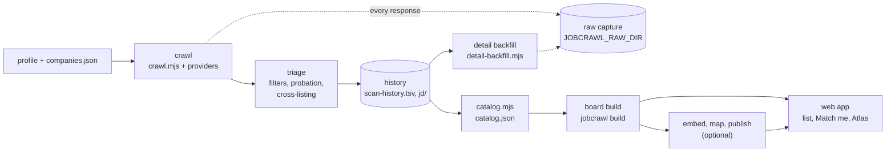

# jobcrawl

[](https://github.com/egidinas/jobcrawl/actions/workflows/test.yml)
[](LICENSE)


jobcrawl crawls the public job boards of a field's employers, keeps a complete history of what each board listed and when, cleans and
classifies the roles, embeds them, and explores them in a static web app with three views: a searchable list of the roles, **Match me**
(rank the roles by a CV, a few statements or free text) and the **Atlas** (a map of the roles, grouped by meaning).

Everything that depends on the field comes from a **profile**: a folder with the employers to poll, the keywords, the regions, the field
tags, the seniority bands and the map settings. `profiles/aerospace` is the reference profile (aerospace, space, defence and photonics
roles from European employers). `profiles/minimal` is the smallest working example.

Matching and the map run in the browser. Nothing you enter, no CV and no rating, is uploaded.

**At a glance** (2026-11-07):

| | |
|---|---|
| sources | 121 providers: applicant-tracking systems, research portals, config-driven readers for sites without an ATS, USAJOBS and EURES ([table](#supported-sources)) |
| reference deployment | [madenetwork.de/jobs.html](https://madenetwork.de/jobs.html) polls 4,889 enabled boards through 83 of the providers, one cycle every 20 to 40 minutes |
| dependencies | the crawler, the board build and the web app need Node 22 and the Python standard library; embedding and the map are optional extras |
| tests | 166 Node and 196 Python tests, offline (fixtures and local servers), on every push ([CI](.github/workflows/test.yml)) |

## 5-minute demo

Python 3 is all you need to see the web app; there is nothing to install.

```sh
git clone https://github.com/egidinas/jobcrawl
cd jobcrawl
python3 scripts/serve.py --data demo/site
```

Open http://localhost:8000/. The demo holds 1,051 public aerospace roles in Bavaria with short excerpts of their descriptions
(see `demo/README.md`). Match me runs on keywords and the statements without a model; a CV or free text needs the model (step 2 below).

## How it works



1. **Crawl.** `crawler/crawl.mjs` polls every enabled board that is due (`interval_hours`, staggered), 8 boards at a time, each within a
   fetch budget (`timeout_ms`, default 35 s). A provider turns a board's public feed into postings (title, URL, location, date, and the
   description where the feed has it). A board that fails or answers empty three cycles in a row raises an alert in the cycle's notes,
   and a per-provider health line counts boards fetched, failed and empty.
2. **Triage.** Each posting gets a verdict: the title filter, the location filter (`allow`, `allow_country_codes`, `block_hard`, or
   `any_location` for in-scope employers), the probation gate for new boards (roles are held back until the board shows a relevant role;
   a board with only irrelevant roles is disabled), the relevance gate, and cross-listing (an aggregator copy of a role the employer's own
   board lists is a `dup`; the employer's board is the ground truth). Nothing is dropped silently: every verdict leaves a history row,
   the notes count the drops by reason and name the boards whose title-passing roles were dropped for their location.
3. **Detail backfill** (optional). `crawler/detail-backfill.mjs` fetches the detail page of every tracked posting, in or out of scope,
   through the same provider code, a budget of requests per run, one request at a time per host.
4. **Raw capture** (optional). With `JOBCRAWL_RAW_DIR` set, every response of the crawl and the backfill is stored byte for byte, once
   per content, with a daily index, so the board can be rebuilt from first-party data at any time.
5. **Board build.** `crawler/catalog.mjs` writes the open roles to `catalog.json`; `jobcrawl build` derives regions, field tags and
   seniority from the profile and writes the board files the web app reads. `embed`, `map` and `publish` add Match me and the Atlas.

[docs/ARCHITECTURE.md](docs/ARCHITECTURE.md) has every stage with its inputs and outputs, the crawler's state files and every file format.

## Supported sources

<!-- provider-table:begin (generated by scripts/provider_table.mjs; do not edit by hand) -->
121 providers in 6 modules. The `provider` value of a companies-file entry is the id below; without one, the
first provider whose detect() recognises the entry's `careers_url` is used (registry order).

| module | what it covers | providers |
|---|---|---:|
| [`providers.mjs`](crawler/providers.mjs) | Applicant-tracking systems and career sites | 72 |
| [`providers-extra.mjs`](crawler/providers-extra.mjs) | Further ATS families (ported approaches, see NOTICE.md) | 42 |
| [`providers-research.mjs`](crawler/providers-research.mjs) | Research-organisation portals | 3 |
| [`providers-generic.mjs`](crawler/providers-generic.mjs) | Config-driven readers for sites without an ATS | 2 |
| [`providers-usajobs.mjs`](crawler/providers-usajobs.mjs) | Public-sector source (API key from the environment) | 1 |
| [`providers-eures.mjs`](crawler/providers-eures.mjs) | Aggregator (unofficial backend, attribution kept) | 1 |

<details><summary><b>Applicant-tracking systems and career sites</b> (<code>providers.mjs</code>, 72)</summary>

| provider | recognises (from its detect()) | detail fetch |
|---|---|:---:|
| `greenhouse` | `(?:boards or job-boards)(?:.eu)?.greenhouse.io/(?:embed/job_board\?...` |  |
| `ashby` | `jobs.ashbyhq.com/([\w.%-]+)` |  |
| `lever` | `jobs(?:.eu)?.lever.co/([\w.-]+)` |  |
| `personio` | `([\w-]+).jobs.personio.(?:de or com)` | yes |
| `smartrecruiters` | `(?:jobs or careers).smartrecruiters.com/([\w-]+)` | yes |
| `teamtailor` | `careers.reorbit.space`, `careers.revolvspace.com` (+4) |  |
| `recruitee` | `([\w-]+).recruitee.com`, `career.quantum-systems.com` (+2) |  |
| `sitemap` | set by the entry (`slug` or `careers_url`) |  |
| `csod` | `https://[\w-]+.csod.com/ux/ats/careersite/\d+` |  |
| `eightfold` | `https://[\w-]+.eightfold.ai/` |  |
| `softgarden` | `([\w-]+.softgarden.io)` |  |
| `rheinmetall` | `https://rheinmetall.com/` |  |
| `workable` | `apply.workable.com/([\w-]+)` |  |
| `workday` | `([\w-]+).(wd\d+).myworkdayjobs.com/(?:[a-z]{2}-[A-Z]{2}/)?([\w-]+)` | yes |
| `mycareersfuture` | `mycareersfuture.gov.sg` |  |
| `spacecareers` | `space-careers.com` | yes |
| `spaceindividuals` | `spaceindividuals.com` |  |
| `jobsinphotonics` | `jobs-in-photonics.com` |  |
| `dover` | set by the entry (`slug` or `careers_url`) |  |
| `jobvite` | `jobs.jobvite.com` |  |
| `phenom` | set by the entry (`slug` or `careers_url`) |  |
| `rippling` | `ats.rippling.com/([\w-]+)` | yes |
| `bamboohr` | `([\w-]+).bamboohr.com` | yes |
| `cailabs` | `cailabs.com` | yes |
| `spacecapital` | `jobs.spacecapital.com` | yes |
| `umantis` | `recruitingapp-(\d+).de.umantis.com`, `career.diehl.com` (+2) | yes |
| `successfactors` | `jobs.hensoldt.net`, `jobs.rohde-schwarz.com` (+10) |  |
| `tkms` | `jobs.tkmsgroup.com` |  |
| `bwi` | `bwi.de` |  |
| `dassault` | `3ds.com` |  |
| `breezy` | `([a-z0-9-]+).breezy.hr` |  |
| `pinpoint` | `([a-z0-9-]+).pinpointhq.com` |  |
| `avature` | `avature.net`, `jobs.rohde-schwarz.com` |  |
| `oraclecloud` | `([a-z0-9_.-]+.oraclecloud.com)[^\s]*/sites/([a-zA-Z0-9_-]+)` |  |
| `mbda` | `mbda-careers.de` |  |
| `lucca` | `jobs.world.luccasoftware.com/([a-zA-Z0-9_-]+)` |  |
| `onlyfy` | `([\w-]+).onlyfy.jobs` |  |
| `reachmee` | `web\d+.reachmee.com/ext/I\d+/\d+/main\?[^"'<>\s]*validator=[^"'<>\s...` | yes |
| `bite` | `data-bite-jobs-api-listing="([\w.-]+:[\w-]+)"`, `cs-assets.b-ite.com/([\w.-]+)/jobs-api/([\w-]+)(?:.min)?.js` |  |
| `concludis` | `careers.toptica.com` |  |
| `jazzhr` | `([\w-]+).applytojob.com` |  |
| `aerospacelab` | `aerospacelab.com/jobs` |  |
| `prospective` | `([\w-]+).prospective.ch` |  |
| `gilmourspace` | `gspace.com` |  |
| `tttech` | `tttech(?:-auto)?.com` |  |
| `cvwarehouse` | `companyGuid=([a-f0-9-]+)` |  |
| `factorial` | `([\w.-]+.factorial(?:hr)?.(?:com or it or es or de or io or pt))`, `([\w-]+).factorial.com` |  |
| `dsi` | `dsi(?:-as)?.space or dsi-as.de` |  |
| `hps` | `hps-gmbh.com` |  |
| `avilus` | `avilus.com` |  |
| `swissto12` | `swissto12.com` |  |
| `infiniteorbits` | `infiniteorbits.io` |  |
| `sybilla` | `sybillatechnologies.com` |  |
| `telesat` | `telesat.com` |  |
| `theva` | `theva.de` |  |
| `gomspace` | `gomspace.com` |  |
| `qascom` | `qascom.com` |  |
| `join` | `join.com/companies/([\w-]+)` | yes |
| `siigroup` | `sii-group.de` | yes |
| `hrlab` | `app.hrlab.de/(?:[a-z]{2}/)?jobs/([\w-]+)` | yes |
| `eso` | `recruitment.eso.org` |  |
| `adp` | `workforcenow.adp.com[^#]*[?&]cid=([0-9a-f-]{36})`, `[?&]ccId=([\w]+)` |  |
| `ultipro` | `(recruiting\d*.ultipro.(?:com or ca))/([A-Za-z0-9]+)/JobBoard/([0-9...` |  |
| `icims` | `([\w-]+.icims.com)` |  |
| `jibe` | `([\w.-]+)/(?:[\w-]+/)?jobs/[\w-]+\?lang=[a-z-]+` |  |
| `comeet` | `comeet.(?:com or co)/jobs/([\w-]+)/([0-9A-F.]+)` |  |
| `gem` | `jobs.gem.com/([\w-]+)` |  |
| `deel` | `jobs.deel.com/(?:job-boards/)?([\w-]+)` |  |
| `paylocity` | `recruiting.paylocity.com/recruiting/jobs/(?:All or Details)/([0-9a-...` |  |
| `zohorecruit` | `([\w.-]+)/jobs/Careers` |  |
| `odoo` | `([\w-]+.odoo.com)/jobs` |  |
| `jobscore` | `jobscore.com/(?:careers or jobs)/([\w-]+)` |  |

</details>

<details><summary><b>Further ATS families (ported approaches, see NOTICE.md)</b> (<code>providers-extra.mjs</code>, 42)</summary>

| provider | recognises (from its detect()) | detail fetch |
|---|---|:---:|
| `taleo` | `.taleo.net/careersection` |  |
| `radancy` | set by the entry (`slug` or `careers_url`) |  |
| `beesite` | `.beesite.de` |  |
| `pageup` | `careers.pageuppeople.com` |  |
| `consider` | set by the entry (`slug` or `careers_url`) |  |
| `applitrack` | `applitrack.com` |  |
| `neogov` | `(?:schooljobs or governmentjobs).com/careers` |  |
| `eploy` | set by the entry (`slug` or `careers_url`) |  |
| `flowxtra` | `(?:^ or // or .)flowxtra.com` |  |
| `amazon` | `(^ or .)amazon.jobs`, `/(?:[a-z-]+/)?jobs/\d+` |  |
| `trakstar` | `.hire.trakstar.com` |  |
| `traffit` | `.traffit.com` |  |
| `paradox` | `.paradox.ai` |  |
| `manatal` | `careers-page.com` |  |
| `appone` | `.appone.com` |  |
| `applicantstack` | `.applicantstack.com` |  |
| `careerplug` | `.careerplug.com` |  |
| `hiringthing` | `.hiringthing.com` |  |
| `paycor` | `recruitingbypaycor.com` |  |
| `opencats` | `index.php\?m=careers` |  |
| `hrmdirect` | `.hrmdirect.com` |  |
| `paycom` | `paycomonline.net/v4/ats` |  |
| `hireclick` | `.hireclick.com` |  |
| `tenstreet` | `pulse.tenstreet.com` |  |
| `hibob` | `.careers.hibob.com` |  |
| `harri` | `(?:^ or // or .)harri.com` |  |
| `higherme` | `higherme.com` |  |
| `edjoin` | `edjoin.org` |  |
| `workstream` | `workstream.us/j/` |  |
| `gupy` | `.gupy.io` |  |
| `dayforce` | `jobs.dayforcehcm.com` |  |
| `talentsoft` | `.talent-soft.com` |  |
| `rexx` | `.rexx-systems.com` |  |
| `varbi` | `.varbi.com` |  |
| `emply` | `.career.emply.com` |  |
| `easycruit` | `.easycruit.com` |  |
| `dvinci` | `.dvinci-hr.com` |  |
| `hirehive` | `.hirehive.com` |  |
| `digitalrecruiters` | `.digitalrecruiters.com` |  |
| `flatchr` | `careers.flatchr.io` |  |
| `intervieweb` | `.intervieweb.it` |  |
| `attrax` | set by the entry (`slug` or `careers_url`) |  |

</details>

<details><summary><b>Research-organisation portals</b> (<code>providers-research.mjs</code>, 3)</summary>

| provider | recognises (from its detect()) | detail fetch |
|---|---|:---:|
| `mpg` | `?#] or $)` |  |
| `desy` | `desy.de/(?:career/job_offers or karriere/stellenangebote)/` |  |
| `hzdr` | `hzdr.de/db/!JobList\b` |  |

</details>

<details><summary><b>Config-driven readers for sites without an ATS</b> (<code>providers-generic.mjs</code>, 2)</summary>

| provider | recognises (from its detect()) | detail fetch |
|---|---|:---:|
| `paginated_list` | set by the entry (`slug` or `careers_url`) |  |
| `jsonld_direct` | set by the entry (`slug` or `careers_url`) |  |

</details>

<details><summary><b>Public-sector source (API key from the environment)</b> (<code>providers-usajobs.mjs</code>, 1)</summary>

| provider | recognises (from its detect()) | detail fetch |
|---|---|:---:|
| `usajobs` | `/api/search/?`, `(www.)?usajobs.gov` (+1) |  |

</details>

<details><summary><b>Aggregator (unofficial backend, attribution kept)</b> (<code>providers-eures.mjs</code>, 1)</summary>

| provider | recognises (from its detect()) | detail fetch |
|---|---|:---:|
| `eures` | `europa.eu`, `/eures/portal/jv-se/(?:search or advanced)/?` | yes |

</details>
<!-- provider-table:end -->

A board without an ATS can often still be read: `sitemap` (the site's sitemap plus each page's JobPosting markup), `jsonld_direct` (a
careers page that links JobPosting pages) and `paginated_list` (a JSON or HTML list described by a few fields in the entry). The
profiler below finds which of them fits a site.

## Profiles

A profile is a folder with a `profile.json` and a `companies.json`:

* `companies.json`: the boards to poll (`tracked_companies`: name, `provider` and `slug` or a `careers_url`, `interval_hours`,
  `probation`, `any_location`, `max_jobs`, `timeout_ms`, ...), the global `title_filter` and the `location_filter`;
* `profile.json`: the crawl settings (user agent, data folder, relevance keywords), the regions (`scopes`), the field tags (`fields`),
  the seniority bands (`levels`), the statements and personas of Match me, and the map settings.

Start from `profiles/minimal` (three software employers in Germany). [docs/PROFILES.md](docs/PROFILES.md) walks through writing a profile
for another field; [profiles/schema.md](profiles/schema.md) lists every key, its type and its default.

## Responsible crawling

* **Public data only.** The crawler reads the public feeds and pages that employers publish for applicants, never anything behind a
  login. LinkedIn is not crawled; Indeed, Glassdoor and XING are skipped as well.
* **It says who it is.** Requests carry the profile's user agent (`crawl.user_agent`, default
  `Mozilla/5.0 (compatible; jobcrawl; +https://github.com/egidinas/jobcrawl)`), which names the project and where to read about it.
  Two exceptions, kept from the providers' origins and under review: the Workday search API and the SuccessFactors Career Site Builder
  search are called with a browser user agent.
* **robots.txt.** It is read and honoured, `Disallow` rules for the crawler's own token and for `*`, by the `sitemap` and
  `jsonld_direct` providers, by the career-site profiler (which also keeps `Crawl-delay`) and by the SuccessFactors tenant probe. The
  ATS providers read the JSON or XML feeds the vendors publish for embedding job lists on career pages and do not fetch robots.txt.
  Open point: the SuccessFactors provider's Career Site Builder fallback calls `/services/recruiting/v1/jobs`, which many RMK sites
  disallow; the robots-allowed sitemap route exists for those sites and is what the tenant enumeration adds.
* **Gentle by design.** At most 8 boards at a time, each board is fetched only when due (`interval_hours`, capped at 48 hours so a live role is
  confirmed before it would be marked gone; the reference profile polls most boards every 12 to 48 hours), paging providers pause between pages, the detail backfill sends one request at a time per host with a
  delay, and EURES gets at most one request per second across all processes, with backoff on HTTP 429.
* **Attribution.** Aggregator copies carry their source (`meta.source`, the company suffix `(via EURES)`), and the employer's own posting
  always wins over a copy.
* **Before you add a site**, read its terms of use, and poll it no more often than it needs.

## Data model

* **History** (`<data>/scan-history.tsv`): one row per posting ever seen, `url, company, title, location, first_seen, last_seen,
  status, posted`, with status `open`, `extra`, `filtered`, `dup` or `gone`. Rows change status, they are not deleted, so the history is
  a complete record of what each board listed and when.
* **Health and gates** (`source-health.json`, `probation-state.json`, `crawl-state.json`): per board, failure and empty streaks, the
  probation state and when it is next due.
* **Descriptions** (`<data>/jd/`), **metadata** (`job-meta.json`) and the **raw capture** store (`<raw>/objects`, `<raw>/index`).
* **Board files** (`jobs-index.json`, `jobs-desc-XX.json`, `jobs.json`), the match files and `config.json`, which the web app reads.

Every key is in [docs/ARCHITECTURE.md](docs/ARCHITECTURE.md).

## The full pipeline

Node 22 runs the crawler and the web app (no npm packages). The pipeline is Python 3.9 or newer.

```sh
# 1. crawl the employers of the profile into data/catalog.json, and build the board files in data/site (--build)
node crawler/run.mjs --profile profiles/aerospace --data data --build

# 2. optional, for CV and free-text matching: download EmbeddingGemma 2 into models/eg2 (not included; see NOTICE.md)
python3 scripts/fetch_model.py

# 3. optional: embed the roles (and the companies, when the profile names a catalogue) into data/vectors
#    needs requirements-embed.txt (numpy, onnxruntime, tokenizers, onnx)
python3 -m jobcrawl embed --site data/site --model-dir models/eg2 --profile profiles/aerospace

# 4. write the match files and config.json that the web app reads
python3 -m jobcrawl publish --site data/site --profile profiles/aerospace

# 5. optional, after step 3: the atlas layout (needs requirements-map.txt: umap-learn, leidenalg, igraph, scipy),
#    then publish again so the layout is copied into the match folder
python3 -m jobcrawl map --site data/site --profile profiles/aerospace
python3 -m jobcrawl publish --site data/site --profile profiles/aerospace

# 5b. optional: the geographic cartogram, areas swollen to their share of the roles (numpy; Natural Earth is downloaded once)
python3 -m jobcrawl geomap --site data/site --profile profiles/aerospace

# 6. explore (--models models only when step 2 was run)
python3 scripts/serve.py --data data/site --models models
```

The Makefile wraps these steps (`make crawl build embed publish map serve PROFILE=profiles/aerospace DATA=data`). Without steps 2
and 3 the site works on keywords alone, and there is no atlas. A scheduler runs step 1 every 20 minutes or so; each board is
fetched only when it is due.

Map images: the Atlas page has a "Save as image" button. For a large export of the whole role map and the company map:
`node scripts/export_atlas.mjs --data data/site --out exports --scale 5 [--theme neon|light]` (needs Playwright).

Publishing on a small machine (a router, a static host's build step) without numpy: build the neighbour lists where the vectors are
made (`python3 -m jobcrawl neighbours --site data/site`, written into the vectors folder); publish then copies them and needs only
the standard library.

History: `python3 -m jobcrawl traces --site data/site [--traces DIR]` after each crawl round (numpy) keeps a permanent trace of every
role that was on the board (title, company, location, URL, first and last seen, a 128-number fingerprint), in a folder best kept out of
version control, and derives the weekly trends and the atlas timeline; `publish --traces DIR` copies those two (titles and companies
only, no URLs) into the site.

### Raw capture

Set `JOBCRAWL_RAW_DIR` to keep every feed response the crawler receives, byte for byte (`crawler/rawcapture.mjs`): bodies are stored
once per content, gzipped and named by their SHA-256, and every response gets a line in a daily index (URL, method, status, content
type, hash, size, and the request body for POST calls). The board can then be rebuilt from first-party data at any time, including
the descriptions' HTML structure and provider fields the crawler does not extract. Unchanged boards cost one index line per crawl.

### Detail backfill

The crawl fetches a description only for roles that pass the title filter. `crawler/detail-backfill.mjs` fetches the detail of
every tracked posting, in or out of scope, through the same provider code, so the raw store keeps every response; nothing is
written to `jd/*.md`. `JOBCRAWL_RAW_DIR` is required (without it the fetches would be wasted).

```
node crawler/detail-backfill.mjs --profile <dir> --data <dir> [--budget 400] [--host-delay 1500] [--concurrency 4]
                                 [--statuses extra,filtered,open] [--vendors a,b] [--dry-run]
```

A run stops after `--budget` requests and is resumable: `<data>/detail-backfill.json` records every URL tried (ok, text length,
tries, next retry). The queue order is open roles without a saved text, then extra and filtered roles, then open roles whose
saved text is the clipped copy; newest first within each class. Vendors whose board response already carries every description
(Greenhouse, Ashby, Lever, Personio, Recruitee, Pinpoint, Breezy, Workable) are skipped unless named in `--vendors`. Hosts are
fetched one request at a time with `--host-delay` ms between requests, `--concurrency` hosts in parallel. A failed URL is retried
after 1, 7 and 30 days, then every 90 days. Only one run works a data directory at a time (`<data>/detail-backfill.lock`).

### USAJOBS

US federal roles come from USAJOBS itself (`crawler/providers-usajobs.mjs`), a first-party source: the Search API of data.usajobs.gov
returns every announcement of a query with its full text, so an employer entry is a query (`careers_url` of the form
`https://data.usajobs.gov/api/Search?Organization=NN&DatePosted=60`, agency codes as a semicolon list, or a www.usajobs.gov search
URL). The API needs a free key from https://developer.usajobs.gov: set `USAJOBS_API_KEY` and `USAJOBS_EMAIL` (the e-mail the key was
issued to) in the environment; without them the board fails loudly instead of reporting no roles. The announcements are public data
that may be redistributed; each role is attributed to USAJOBS (`meta.source`) and links to its announcement.

### EURES and other aggregators

EURES, the European Employment Services portal of the European Labour Authority (ELA), carries the vacancies of the national public
employment services: `crawler/providers-eures.mjs` calls the portal's own search backend. That backend is undocumented and unofficial,
so it can change or close without notice; what was observed is in [docs/sources/eures-api.md](docs/sources/eures-api.md). The
vacancies are copyright ELA, re-use authorised with ELA acknowledged as the source (https://eures.europa.eu/legal-notice_en): every
EURES role carries `meta.source = "EURES (ELA)"` and the company suffix `(via EURES)`, so the cross-listing rules treat it as a copy of
the employer's own posting. A tracked EURES board is a portal search (`provider: "eures"`, `slug: "<keyword>|<country codes>"`), read 50
vacancies per page, one page per second, newest first, at most 2,000 per crawl. In employer mode (`slug: "employer:<name>|<codes>"`;
`crawler/eures-employer-boards.mjs` writes one such board per directly tracked employer) a board collects the EURES copies of that
employer's own postings for their richer metadata, keeping only the vacancies whose employer name matches.

## Finding boards

A direct poll of an employer's own board is always preferable to an aggregator copy. The discovery tools write lists for a human to
review; none of them changes what is crawled until an entry is added to the companies file (the profiler's `splice` adds entries on
probation).

| tool | what it does |
|---|---|
| `crawler/discover.mjs` | finds boards not tracked yet from URLs you have (the history's apply links, careers pages, names), probes each live feed and prints a ready-to-paste entry |
| `crawler/ats-resolve.mjs` | finds a named employer's board by probing the slug conventions of the common ATS vendors |
| `crawler/profiler.mjs` | for sites without a known ATS: tries JSON-LD, sitemaps, RSS, repeated link groups, the page's own XHR (headless browser, optional) and a local model; honours robots.txt and Crawl-delay; verifies with the provider's own fetch before it writes an entry |
| `crawler/cc-harvest.mjs` | enumerates ATS tenants from the Common Crawl index (Greenhouse, Lever, Ashby, Workday, Personio, Recruitee, Teamtailor, JOIN, BambooHR, SmartRecruiters, Workable, d.vinci, umantis, rexx, onlyfy, BITE, and SAP SuccessFactors tenants via `crawler/rmk.mjs`), probes each board once and scores it against the profile |
| `crawler/aggregator-employers.mjs` | groups the history's aggregator rows by employer and lists the ones without a direct board |

## Testing

```sh
make test                                   # both suites
node --test 'crawler/tests/*.test.mjs'      # crawler: providers on recorded or synthetic fixtures, full crawls against a local server
python3 -m unittest discover tests          # pipeline: board, classification, index, publish, map, traces
```

The tests use no network: provider tests run on fixtures (captured pages with personal data replaced, or synthetic ones) with `fetch`
stubbed, and the crawl tests serve their boards from `127.0.0.1`. CI ([.github/workflows/test.yml](.github/workflows/test.yml)) runs
the Node suite on Node 22 and the Python suite on Python 3.9 and 3.12 on every push and pull request.

## Contributing

Issues and pull requests are welcome. For a change to the crawler:

* **A new provider** goes into `crawler/providers.mjs` (or `providers-extra.mjs` for a further ATS family) with `detect(url)` (the slug,
  or `null`), `fetch(slug, entry)` (postings `{ title, url, location, postedAt, description? }`) and, when the list has no text,
  `fetchDescription(job)`. A board that is not readable must throw, never return `[]`: an empty answer marks every stored posting gone
  after three days, an error is counted by source health and retried. Add a test on a fixture (replace any person's name, e-mail or
  phone number with synthetic values) and regenerate the provider table: `node scripts/provider_table.mjs --write` (a test fails while
  it is out of date).
* **A filter or triage change** gets a crawl test against the local server (`crawler/tests/location-filter.test.mjs` is a template).
* Keep the crawler free of dependencies (Node 22 standard library only) and the board build on the Python standard library.
* Note the change in [CHANGELOG.md](CHANGELOG.md).

## Reference implementations

* https://madenetwork.de/jobs.html: the aerospace board, with Match me and the Atlas, built from the reference profile.
* https://jobs.jmeyer.space: the same data in another layout.

This repository is a standalone version of the pipeline behind the first of these. Their branding, pages and the other things
that belong to those sites are not included.

## Not included

* the site builders and the branding of the reference sites, and their event, partner and people pages;
* the private job-search pipeline that uses the crawl as its first stage;
* the LLM classifiers (the heads trained on the classified roles);
* the company enrichment scripts and the ATS intelligence page;
* model weights: `scripts/fetch_model.py` downloads them under the Gemma Terms of Use, they are never committed;
* full job texts in the demo (the demo carries 300-character excerpts only).

## Documentation

* [docs/ARCHITECTURE.md](docs/ARCHITECTURE.md): the stages, the crawler's state and every file format.
* [docs/PROFILES.md](docs/PROFILES.md): writing a profile.
* [profiles/schema.md](profiles/schema.md): every profile and companies-file key.
* [docs/METHODS.md](docs/METHODS.md): the methods behind Match me and the Atlas, and what was measured.
* [docs/sources/eures-api.md](docs/sources/eures-api.md): the EURES search backend as observed.
* [demo/README.md](demo/README.md): the demo data, where it comes from, the excerpt rule and how to rebuild it.
* [CHANGELOG.md](CHANGELOG.md): what changed, grouped by release period.

## Licences

* The code is MIT licensed ([LICENSE](LICENSE), copyright 2026 jobcrawl contributors).
* Third-party code and data, and the terms of the model, are listed in [NOTICE.md](NOTICE.md).
* The demo data is public job postings; see `demo/README.md` for the terms of the excerpts and how to ask for a removal.
