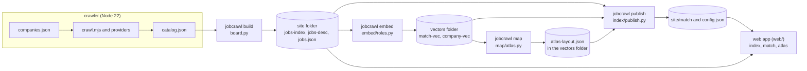

# Architecture

jobcrawl is a chain of stages. Each stage reads files written by the one before and writes its own, so any stage can be run, checked
and replaced on its own. The field-specific parts come from the profile (`profiles/schema.md`); the stages are the same for every field.

Read the diagram from left to right. `publish` runs twice in the full pipeline: once to write the match files the map needs (the statements
and the neighbours), and once after `map` to copy the atlas layout into the match folder.

## Stages

| stage | module | reads | writes | needs |
|---|---|---|---|---|
| crawl | `crawler/crawl.mjs`, `crawler/providers.mjs`, `crawler/providers-extra.mjs`, `crawler/relevance.mjs` | profile `crawl`, `companies.json` | `catalog.json` (in the data folder) | Node 22, network |
| catalog | `crawler/catalog.mjs` | the crawl's history | `catalog.json` | Node 22 |
| geo and sanitise (optional) | `jobcrawl/geo/` (`sanitize.py`) | the catalog | the catalog's locations | Python 3.9 |
| board | `jobcrawl/board.py` (`jobcrawl build`) | `catalog.json`, profile `fields`, `levels`, `scopes` | `jobs-index.json`, `jobs-desc-XX.json`, `jobs.json` | standard library |
| embed | `jobcrawl/embed/` (`jobcrawl embed`) | site folder, profile `embed`, the model folder | `match-vec.*`, `company-vec.*` in the vectors folder | `requirements-embed.txt` |
| index | `jobcrawl/index/match_index.py` | site folder, profile `scopes`, `levels` | `match-bm25.json`, `match-attrs.json` | standard library |
| statements and neighbours | `jobcrawl/index/prefs.py`, `jobcrawl/index/neighbours.py` | site folder, vectors, profile `statements` | `match-prefs.json`, `role-nb.bin`, `role-graph.json` | numpy (neighbours) |
| publish | `jobcrawl/index/publish.py` (`jobcrawl publish`) | everything above, profile | `match/` folder, `config.json` | standard library, numpy with vectors |
| map | `jobcrawl/map/atlas.py`, `jobcrawl/map/labels.py` (`jobcrawl map`) | vectors, site folder, match-prefs, profile `map`, `scopes` | `atlas-layout.json` (in the vectors folder) | `requirements-map.txt` |
| web | `web/` (`index.html`, `match.html`, `atlas.html`), `scripts/serve.py` | `config.json`, `jobs-*.json`, `match/`, optional `models/` | the browser's own state only | a browser; a static server |

Where the files go: the **site folder** (`data/site`, or `--site`) is everything the web app loads. The **vectors folder** defaults to
the sibling `data/vectors`, so vectors and the atlas stay out of the published folder until `publish` copies the parts it needs.

## The data contract

Every file the stages pass on, with its keys. Standard JSON, UTF-8, written by the stage named.

### catalog.json (crawler; read by `jobcrawl build`)

A list of role objects (or `{"items": [...]}`), one per posting, as `crawler/catalog.mjs` writes them. The board reads:

| key | meaning |
|---|---|
| `url` | the posting link (required; the role id is derived from it) |
| `title` | the posting's title (required) |
| `company` | the employer's name as the board shows it |
| `location` | the location text as given (`Unspecified` when empty) |
| `first_seen` | when the crawler first saw the role (`YYYY-MM-DD`) |
| `description` | the description text (the board keeps it in full unless `--excerpt N`) |

The crawler adds more keys (source, posting date, last seen, metadata). The board ignores them.

### jobs-index.json (board)

`[[id, title, company, url, company_slug], ...]`, newest first (by `d`, then company and title). `id` is the first 8 hex digits of
`sha1(url)`, so an id is stable across crawls of the same posting.

### jobs-desc-XX.json (board)

`{id: {t, c, cs, u, l, r, sc, lv, d, tg, x}}`, one file per first two hex digits of the id (`XX`, 256 files at most).

| key | type | meaning |
|---|---|---|
| `t` | string | title |
| `c` | string | employer name |
| `cs` | string | employer slug (lower case, ASCII, no "(via ...)"); may be empty |
| `u` | string | posting URL |
| `l` | string | location text (empty for `Unspecified`) |
| `r` | string | region label: the country of the first place, else the narrowest scope (English) |
| `sc` | list of scope ids | the profile's scopes the role belongs to (narrowest first, and every wider one) |
| `lv` | string | seniority band code (`levels[].code`) |
| `d` | string | first-seen date, `YYYY-MM-DD` |
| `tg` | list of field ids | the field tags (at most `max_field_tags`) |
| `x` | string | the description text: full in a private build; the demo carries excerpts of at most 300 characters |

### jobs.json (board)

The first 500 roles in the order of `jobs-index.json`, each with its `id` and the keys of `jobs-desc-XX.json`.

### match/match-bm25.json (publish)

Keyword postings: `{n, avgdl, ids, len, idf, post}`. `ids` are the roles in index order; `len` the length of each role's text in terms;
`idf` the weight per term; `post` maps a term to a flat list `[role index, count, role index, count, ...]`. Terms in 2 to 40 % of the roles
only. The title counts 3 per word, the first 3,000 characters of the description 1 per word.

### match/match-attrs.json (publish)

`{scopes, levels, regions, fields, langs, a}`. `a` has one row per role in index order:
`[scope bits, level index, has description, region index, field bits, language index]`. Bit `k` of the scope bits is `scopes[k]`;
`levels` lists `""` and then the codes by rank; `langs` is `en, de, fr, es`.

### match/match-vec.bin and match/match-vec.json (embed, copied by publish)

`match-vec.bin`: int8 rows of 256 numbers, one per role in `match-vec.json` `ids`, each row unit length times 127 (rounded and clipped).
`match-vec.json`: `{dim, mean, ids, prompt, text, lang_dirs, lang_dirs_from}`. `mean` is the centre the rows were taken from,
`lang_dirs` the German, French and Spanish directions removed from every vector (`lang_dirs_from` counts the roles per language).
A visitor's CV and any new vector are brought into the same space with these two.

### match/company-vec.bin and match/company-vec.json (embed, copied by publish)

The same format for companies: `company-vec.json` is `{dim, slugs, text, lang_dirs}`.

### match/role-nb.bin and match/role-graph.json (publish, neighbours)

`role-nb.bin`: `uint16`, 10 per role in `match-vec.json` order, the most similar roles (at most 2 from one employer, one per
duplicate group); 65535 means none. `role-graph.json`: `{k, ids_from, sim, dup}`, with `sim` the similarity of each neighbour
(0 to 100) and `dup` the groups of near-duplicate postings (the same job listed again).

### match/match-prefs.json (publish, statements)

`{dim, prefs: [{id, a, b, v, mu, sd, auc, n}]}`. `a` and `b` are the two poles (`[en, de]`), `v` the direction in the vector space,
`mu` and `sd` the mean and spread of all roles along it (for the z-score in the browser), `auc` how well it separates held-out roles,
`n` the number of labelled roles at each pole. Only statements with `auc` of at least 0.75 are published.

### match/atlas-layout.json (map)

`{version, k, layout_k, scopes, resolution, language_removed, reps_per_company_and_group, roles, companies}`.

* `roles` and each entry of `scopes` (keyed by scope id; the `any` scope is `roles`) are one map:
  `{ids, x, y, c1, c2, rep, regions, hoods, links}`. `x` and `y` place each role in the unit square, `c1` and `c2` are its region and
  neighbourhood numbers, `rep` the position, among the representatives, of the representative a role sits next to (-1 for a representative itself), `regions` and `hoods` are
  the groups: `{n, words, fields, lean, xy, label}` (`label` is `[en, de]` when the labels file names the group), and `links` the
  connections between groups `[a, b, weight]`.
* `companies` is the companies map: `{names, about, field, slugs, x, y, c1, roles, regions}`, one entry per company.

### config.json (publish)

What the web app reads first: `{name, title, tagline, languages, scopes, fields, levels, personas, glossary, statements_file,
accent, links}`. Its values come from the profile, and the app takes its labels, scopes and personas from it.

### Profile files

| file | written by | read by | keys |
|---|---|---|---|
| `profile.json` | you | every stage | `profiles/schema.md` |
| `companies.json` | you | the crawler | `tracked_companies`, `title_filter`, `location_filter` |
| `companies_catalogue` (the path is in the profile) | you | `jobcrawl embed`, `jobcrawl map` | `{companies: [{slug, name, field, arch_name, profile}]}` |
| `labels.json` (`map.labels_file`) | you, or a copy of a reference | `jobcrawl map` | `{roles: {scope or worldwide: {regions: [...], hoods: [...]}}, companies: [...]}`, each group `{en, de, sample: [ids]}` |

## Where things are decided

* A role's scopes come from the places in its location text (`jobcrawl/geo`), matched to the profile's scopes (`classify/scopes.py`).
* Field tags come from the profile's keyword rules, applied to title, description and employer (`classify/fields.py`).
* Seniority comes from the first matching level pattern (`classify/levels.py`).
* The text the model reads is the clean title plus the first `embed.text_chars` characters of the work text (`text/work_text.py`).
* The atlas groups and places the roles; the names come from the labels file when it names the group, otherwise from the group's
  distinctive title words.
